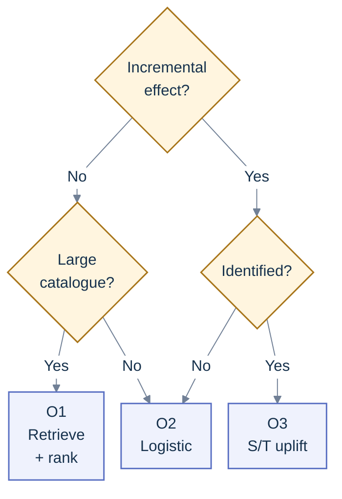
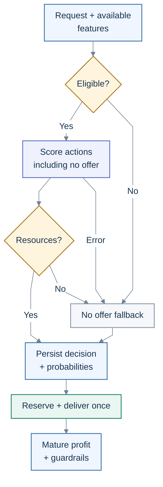

# Offer recommendation: choose the action that changes the outcome

**About 25 hours for the learning project.** &nbsp;·&nbsp; [Chapter 9](README.md) &nbsp;·&nbsp;
[Index](../README.md) &nbsp;·&nbsp; [Resources](resources/README.md)

**The short version.** Start with eligibility rules and a measurable baseline. For a small offer
catalogue and customer data in tables, compare logistic regression with CatBoost or LightGBM. When
the offer costs money or changes how customers behave, learn **incremental contribution profit
against a no-offer control** from randomised assignments: the extra profit compared with sending
nothing. For a large catalogue, use retrieval and ranking. Consider contextual bandits only once you
can log action probabilities and measure outcomes reliably. These solve different problems, and no
model is best for all.

You finish with a decision service, a reproducible evaluation and an experiment plan, which a
learning project can prepare in about 25 hours. A properly powered experiment and its full outcome
window take extra calendar time.

**In this guide:** [Decision contract](#1-decide-what-offer-means) ·
[Data](#3-build-the-data-around-decision-opportunities) ·
[Model decision tree](#model-selection-decision-tree) ·
[Evaluation](#6-evaluate-the-policy-honestly) · [Serving](#9-serve-log-reconcile-and-roll-back) ·
[Completion gates](#before-you-call-it-complete)

## Your learning plan

Build this after the validation work in [Chapter 3](../03-core-machine-learning/README.md) and the
serving work in [Chapter 6](../06-production/README.md). Deep learning is optional here.

Start with the [causal primer](causal-primer.md). The 25-hour schedule assumes small, prepared data,
your earlier environment and a reused service boundary. Finding data, a new delivery integration or
approval for a production campaign needs extra time. First finish one supported baseline for a
single binary action. Pretrained causal models, generative ranking and bandits are optional depth.

| Session | Hours | Do this                                                                                             | Done when                                                                         |
| ------- | ----: | --------------------------------------------------------------------------------------------------- | --------------------------------------------------------------------------------- |
| 1       |     3 | Define action, no-offer control, profit, decision time, and measurement window                      | A one-page decision contract has an owner and examples                            |
| 2       |     5 | Audit data, implement features available at decision time, and build rules                          | You can replay one decision and trace every input                                 |
| 3       |     5 | Compare logistic regression and one boosted tree; build a treatment-effect baseline if data permits | Validation table separates predictive quality from policy value                   |
| 4       |     5 | Evaluate profit, uncertainty, overlap, fatigue, and important customer segments                     | The proposed policy beats the appropriate baseline or you explain why it does not |
| 5       |     4 | Serve the policy, implement logs, budget reservation, and fallback                                  | Invalid, repeated, stale, and timeout requests behave correctly                   |
| 6       |     3 | Write the experiment and rollout memo; rehearse the project story                                   | Someone else can reproduce the result and decide what evidence is missing         |

## 1. Decide what “offer” means

Two business requests often arrive under the same name.

| Request                               | Example                                                                       | Learning problem                                          | Evidence you need                                                                                            |
| ------------------------------------- | ----------------------------------------------------------------------------- | --------------------------------------------------------- | ------------------------------------------------------------------------------------------------------------ |
| Recommend a relevant product or plan  | Which of 50,000 products should appear on the homepage?                       | Candidate retrieval and ranking                           | Customer–item interactions, item metadata, exposure and position logs                                        |
| Recommend an incentive or next action | Should this customer receive free shipping, a coupon, a reminder, or nothing? | Treatment-effect estimation and constrained policy choice | Eligible decision opportunities, assigned actions, a control group, action probabilities, outcomes and costs |

A product can be relevant without needing a discount. A customer may be likely to redeem a coupon
and just as likely to buy at full price. A model trained to predict redemption often favours such
customers, because redemption is easier to predict than **behaviour changed by the offer**.
Attribution reports and conversion probabilities cannot show incrementality, the sales the offer
caused.
[Microsoft's incrementality documentation](https://learn.microsoft.com/en-us/xandr/data-science-toolkit/incrementality)
draws the same line between attributed conversions and causal impact.

For this guide, picture a retailer or subscription service with a small, explicit action set:
`no_offer`, `reminder`, `free_shipping`, and `coupon_10`. A reminder is an active treatment if it
sends a message. The no-offer control gets your defined usual experience. Note whether that includes
other campaigns. For retention, connect this policy to the [churn guide](churn.md). For an offer
that changes the selling price, use the demand and margin method in the
[pricing guide](price-recommendation.md).

Write the contract before you choose a model:

- **Decision:** one action for an eligible customer or account, at a stated time, through a stated
  channel. If the decision is a whole ranked slate, say so, because its logging and evaluation
  differ.
- **Outcome:** contribution profit over, for example, the next 30 days, with time for returns to
  arrive. Count every transaction, whatever the coupon redemption or click attribution.
- **Comparison:** a no-offer policy and the current business policy. A new policy must beat both, on
  the same eligible population and accounting rules.
- **Constraints:** consent, eligibility, stock, minimum margin, contact limits, total spend,
  concurrent campaigns, and any limits the business sets.
- **Guardrails:** complaints, unsubscribes, returns, service load, and longer-term buying or renewal
  behaviour. Set the thresholds that matter before you see the result.

## 2. Turn the target into a decision

Let `x` hold what is known at decision time, `a` be an eligible action, and `0` be no offer. Define:

```text
Q(x, a) = E[contribution profit over the window if assigned action a | x]
delta(x, a) = Q(x, a) - Q(x, 0)
chosen action = argmax delta(x, a), among feasible actions including 0
delta(x, 0) = 0
```

This is a conditional average effect: the expected difference for customers with similar observed
context. You see only one of the two outcomes for each person, so you cannot directly label anyone's
true uplift. Take the logged reward from the same accounting contract: contribution over the window
minus the specified incentive, fulfilment and contact costs, including failed delivery attempts. If
net contribution already subtracts a cost, do not subtract it again. Use that net reward for both
`Q` and policy evaluation, no-offer arm included.

**A worked example.** Suppose an order contributes ₹500 before the incentive. The incentive applies
to every completed order in its assigned arm, and sending the offer costs ₹2. Assume no returns or
other effects. Suppose randomised data and a validated model gave these made-up purchase
probabilities for one customer context:

| Assigned action | Purchase probability | Contribution per purchase |            Expected profit | Increment against no offer |
| --------------- | -------------------: | ------------------------: | -------------------------: | -------------------------: |
| No offer        |                 0.20 |                      ₹500 |        `0.20 × 500 = ₹100` |                         ₹0 |
| ₹50 benefit     |                 0.25 |                      ₹450 | `0.25 × 450 − 2 = ₹110.50` |                     ₹10.50 |
| ₹100 benefit    |                 0.30 |                      ₹400 |    `0.30 × 400 − 2 = ₹118` |                        ₹18 |
| ₹200 benefit    |                 0.35 |                      ₹300 |    `0.35 × 300 − 2 = ₹103` |                         ₹3 |

The largest benefit wins on conversion but loses to the ₹100 benefit on incremental profit. If the
₹100 benefit were infeasible, the policy would pick from the remaining feasible actions. If every
active action lost money against no offer, choose no offer. In a real campaign, discounts may apply
only on redemption, baskets can change, and returns add later costs. Measure those parts, or model
net profit directly, instead of forcing this simple formula onto the business.

**Try it yourself.** Sending the offer now costs ₹10 instead of ₹2, with the same purchase
probabilities. Recompute the increments. Which action does the policy choose, and which active
action now loses money against no offer?

<details>
<summary>Hint and explained answer</summary>

Subtract ₹10 instead of ₹2. The ₹50 benefit gives `0.25 × 450 − 10 = ₹102.50`, an increment of
₹2.50. The ₹100 benefit gives `0.30 × 400 − 10 = ₹110`, an increment of ₹10. The ₹200 benefit gives
`0.35 × 300 − 10 = ₹95`, an increment of −₹5. The ₹100 benefit still wins. The ₹200 benefit has the
highest purchase probability but is now worse than no offer. If the ₹100 benefit were infeasible,
the ₹50 benefit's ₹2.50 edge would need an uncertainty check before it could replace no offer.

</details>

A discount paid to customers who would have bought anyway is a real cost. Also check whether the
offer only pulls a future purchase into the window, moves revenue from a higher-margin product, or
pushes out an existing offer. That is how a short-term redemption metric can produce an expensive
policy.

## 3. Build the data around decision opportunities

Each training row is an **eligible opportunity at a decision time**, including those assigned no
offer. A table of redeemed offers alone cannot estimate the comparison above. For each opportunity,
join all relevant purchases, returns and costs over the fixed outcome window. Keep delivered, seen,
clicked and redeemed as separate events.

Use at least these tables. The schema is my suggestion, not a library requirement.

| Table               | Required fields                                                                                                                                                                                                             | Why it exists                                            |
| ------------------- | --------------------------------------------------------------------------------------------------------------------------------------------------------------------------------------------------------------------------- | -------------------------------------------------------- |
| `customer_features` | `customer_id`, `feature_time`, `available_at`, feature values, feature version                                                                                                                                              | Recreate what the service could know at the decision     |
| `offer_catalog`     | `offer_id`, version, active interval, eligibility, channel, cost rule, margin rule, stock dependency                                                                                                                        | Reproduce the feasible action set and accounting         |
| `decisions`         | `decision_id`, customer/account ID, `decision_at`, eligible action IDs, selected action, policy/model version, experiment ID and arm, action probabilities, feature snapshot reference, budget reservation, fallback reason | Audit and evaluate the policy                            |
| `delivery_events`   | `decision_id`, event type, event time, status, position if applicable                                                                                                                                                       | Distinguish assignment from actual delivery and exposure |
| `transactions`      | customer/account ID, transaction time, recorded time, gross revenue, product cost, incentive cost, return/refund, channel                                                                                                   | Compute comparable outcomes for every arm                |
| `outcomes`          | `decision_id`, horizon, cutoff, label maturity, label availability, outcome coverage/status, net contribution, contact cost, conversion, guardrails                                                                         | Store a reproducible training label                      |

For a feature window ending at `decision_at`, use only events whose event time and availability time
are both at or before the decision. A purchase dated Monday but first loaded on Wednesday was
unavailable to Tuesday's service. Joins to today's customer profile, today's stock or a backfilled
lifetime-spend field can all leak future information. Fit encoders, imputers and other learned
transforms on training data only.

Useful inputs include purchase recency and frequency, past contribution, category affinity, tenure,
earlier eligible contacts, time since the last offer, pre-decision complaints, channel preference,
offer/product attributes, calendar context and available stock. Add missingness and history length
so thin histories are visible. Leave out post-assignment opens, coupon redemption and future spend.

**Do not invent labels for unchosen actions.** When a customer gets free shipping, you see their
outcome under that assignment only, not under a coupon or no offer. Products never shown are
unobserved, not confirmed dislikes. Negative sampling can keep retrieval training manageable, but it
changes the training distribution. It does not turn missing interactions into causal negatives.

Make overlapping decisions explicit. One purchase cannot quietly become an independent positive
label for five competing offers. Start with one decision per account per non-overlapping measurement
window, or use a documented design that models sequences and concurrent campaigns.

**Mature does not mean observed.** A closed window with a reconciled transaction and return ledger
can give a zero-purchase outcome. A closed window with lost identifiers, an incomplete channel feed
or an unresolved refund cannot. Store observation status and label availability separately, and
report missing outcomes by assigned arm and pre-decision cohort. Keep every assigned account in the
experiment accounting. Dropping missing outcomes can select customers after assignment, and neither
randomisation nor correct propensities repair that. Reconcile coverage, and for any remaining
exclusions state the assumptions and sensitivity analysis they need, as the
[experiment inclusion guidance](https://www.microsoft.com/en-us/research/articles/diagnosing-sample-ratio-mismatch-in-a-b-testing/)
shows.

## 4. Choose a model according to the evidence

### Model-selection decision tree

Choose the question before the model. The incremental-effect branch asks whether an action changes
profit against no offer. The relevance branch asks which product or offer is likely to interest the
customer. “Identified” means randomised assignment with action support, or an observational design
you can defend. Redemption or targeted-campaign history alone does not pass that gate.

**Check data readiness first.** If you lack the pre-decision features, exposure logs or mature
labels, start with eligibility rules, popularity where supported, and the no-offer baseline. Collect
decision, exposure and outcome logs using the
[data contract](#3-build-the-data-around-decision-opportunities), then follow the tree.



If a retrieved product carries an incentive, use O1 for relevance and follow the incremental-effect
branch separately for the incentive. A better product rank does not show discount lift.

#### O1 — Large catalogue: retrieve, then rank

- **Model and why:** Start with eligible popularity/content candidates. When scoring the whole
  catalogue costs too much, compare retrieval plus LightGBM LambdaRank. Use two-tower retrieval only
  when interaction volume and measured serving needs justify learned embeddings.
- **Minimum data:** For learned models: customer–item interactions, item metadata, candidate and
  exposure/position logs, and meaningful relevance labels with query/session groups.
- **Promotion check:** Improve retrieval recall, ranking quality and latency at the same eligible
  candidate budget. Check cold-start coverage. Continue with
  [retrieval and ranking](#large-catalogue-retrieve-rank-then-apply-the-policy).

#### O2 — Small table or unidentified effects: predict response

- **Model and why:** Fit logistic regression, then compare one CatBoost or LightGBM response model.
  That gives an inspectable baseline and a nonlinear challenger. Comparing predicted response scores
  cannot identify what an intervention caused.
- **Minimum data:** Pre-decision customer/offer/context features, observed assignments or exposures,
  and mature response labels including non-responses, with a deployment-matched holdout.
- **Promotion check:** Compare log loss, rare-event PR metrics, calibration and serving cost on the
  same split. Without effect identification, keep claims predictive and collect randomised
  offer/no-offer data. Redemption prediction is not uplift. Follow the
  [predictive workflow](#predictive-baseline-logistic-regression-then-one-boosted-tree) and
  [collection design](#incentive-selection-randomized-uplift-and-profit-policy).

#### O3 — Identified effects: estimate uplift and choose a profit policy

- **Model and why:** For randomised data, compare arm profit with a regularised S-learner or
  T-learner, respecting assignment probabilities and strata. For observational data, they need a
  defensible confounder-adjustment set, overlap (each action used for similar customers), and effect
  or value estimates that this design justifies. Raw historical arm averages do not show uplift. The
  target is each action's difference from control, over a small supported action set including no
  offer.
- **Minimum evidence:** Mature net outcomes and supported action/control assignments with known
  randomised probabilities, or a defended observational design that handles confounding, overlap,
  treatment definition and interference.
- **Promotion check:** Require held-out incremental contribution, support and uncertainty checks,
  then a policy experiment. Compare a cross-fitted DR-learner or causal forest only when arm sizes
  and heterogeneity justify it. Continue with
  [uplift and profit policy](#incentive-selection-randomized-uplift-and-profit-policy) and
  [policy evaluation](#6-evaluate-the-policy-honestly).

**A bandit is a separate step.** Consider one only once these work: assignment probabilities logged
after constraints, action support, joins to mature rewards, safe exploration and a randomised
holdout. A bandit cannot supply missing causal identification. Use the
[bandit prerequisites](#8-add-bandits-only-when-the-foundation-is-ready) after the fixed-policy
baseline.

### Model comparison ladder

The table below is my suggested order of work. You still choose the model on your own held-out data,
costs and latency budget.

| Data and operating conditions                                          | Start with                                                                          | Consider next                                                                | Main limit                                                                            |
| ---------------------------------------------------------------------- | ----------------------------------------------------------------------------------- | ---------------------------------------------------------------------------- | ------------------------------------------------------------------------------------- |
| Little history; no randomised campaigns                                | Eligibility + recent popularity/category rules + no-offer option                    | Logistic regression and CatBoost/LightGBM response model                     | Prediction under the historical policy does not identify causal uplift                |
| A small offer catalogue and reliable tables                            | Logistic regression; CatBoost or LightGBM with customer, offer and context features | Calibrated response/value models; randomised multi-arm collection            | Optimising predicted response can spend on customers who would buy anyway             |
| Randomised offer/control assignments with mature outcomes              | Arm means; regularised S-learner or T-learner                                       | Cross-fitted DR-learner; compare X-learner or causal forest when appropriate | Noisy effects, insufficient arm samples, and unsupported action/customer combinations |
| A large product catalogue and many interactions                        | Popularity/content rules, item similarity or matrix factorisation                   | Two-tower candidate retrieval + a supervised ranker                          | Relevance is not discount incrementality; exposure and position bias remain           |
| Reliable propensity logs, stable reward, and enough traffic to explore | A fixed policy + randomised holdout                                                 | Contextual bandit with controlled exploration                                | Delayed rewards, unsupported actions, adaptive inference and feedback loops           |

### Predictive baseline: logistic regression, then one boosted tree

Model response from pre-decision context and offer attributes. Compare it with rules and offer-level
historical rates. CatBoost suits tables with categorical customer, product and offer attributes,
because it handles them directly. LightGBM is another good candidate with explicit categorical
handling. Choose on validation quality, memory, training cost, serving latency and team familiarity,
since neither wins everywhere.
[CatBoost's categorical-feature documentation](https://catboost.ai/docs/en/features/categorical-features)
and [LightGBM's advanced topics](https://lightgbm.readthedocs.io/en/stable/Advanced-Topics.html)
describe how each one works.

Measure log loss, PR-AUC for rare conversions, and reliability curves by action and customer
segment. Calibrate on a separate, later validation sample, or with a split that respects time and
account identity. After any negative sampling or class weighting, evaluate at the original
deployment prevalence. Calibration matters because profit uses the size of a probability, not just
its rank.
[The scikit-learn calibration guide](https://scikit-learn.org/stable/modules/calibration.html)
explains why calibration data must be separate from model fitting.

For a small table, an optional tabular foundation-model comparison can be worthwhile. Use the
version-specific guidance in [Chapter 3](../03-core-machine-learning/README.md). Compare on the same
future opportunities, per-action calibration and serving budget. Good outcome prediction does not
make it a causal learner.

This model is a good predictive baseline. Past offers were targeted at different customers for a
reason, and comparing its predictions for two such offers does not remove that reason. Label a
profit simulation built on these predictions as **model-based and unvalidated causally**. Feature
importance or SHAP helps inspect a prediction. It cannot show which features cause customers to
respond.

### Incentive selection: randomized uplift and profit policy

Run a multi-arm campaign with no offer and the candidate actions. Apply the common eligibility
rules, then randomise at a stable account or customer level. At each assignment, record the known
probability of every feasible action. Stratifying by a few pre-decision segments can improve
balance, but the logged probabilities must reflect that design. Every action the new policy might
take needs enough support in its context.

Start with average profit per arm and its uncertainty. When the treatment-effect signal is weak, a
segment or no-offer policy can beat a personalised model. Then compare:

- **S-learner:** one outcome model with the assigned action as an input. It shares information
  across arms, but if the main outcome signal dominates, it may learn little treatment variation.
- **T-learner:** one outcome model per arm, using regularised CatBoost/LightGBM or another suitable
  learner. Subtract the no-offer estimate. It is easy to inspect but can be noisy in small arms.
- **X-learner:** a useful comparison for a binary treatment/control problem with unequal arm sizes.
  Whether it helps depends on how the data was generated.
  [Künzel and colleagues' meta-learner paper](https://arxiv.org/abs/1706.03461) finds that no
  meta-learner is best in every case.
- **DR-learner:** combines outcome and assignment models with cross-fitting. It can handle several
  categorical treatments. Choose and validate the nuisance (helper) and final models separately.
  With a properly randomised design, give the known assignment probabilities to estimators that
  accept them. [EconML's DR guide](https://www.pywhy.org/EconML/spec/estimation/dr.html) covers
  multi-treatment estimation and its assumptions.
- **Causal forest:** an optional comparison when you have enough data to study nonlinear effect
  differences and their uncertainty. Use an estimator and inference method suited to the treatment
  representation. [Wager and Athey's causal-forest paper](https://arxiv.org/abs/1510.04342) develops
  inference under stated assumptions. Those guarantees do not cover any forest trained on a CRM
  export.

Cross-fitting means predicting helper quantities for a row with models fitted on other rows. Keep
related account records together, and leave the final future test period untouched. For
observational data, a defensible causal analysis also needs no unmeasured confounding, overlap, a
well-defined treatment, and a suitable interference assumption. A rich CRM table does not prove
these. An agent's unlogged judgement about which customers need a discount can confound the data
even when the response model has excellent AUC. Double robustness cannot repair an unobserved
confounder, or an action never assigned in a customer context.

### Optional research challengers: learn the effect or the policy?

A treatment-effect model is one part of a decision. You can also learn a restricted policy, such as
a shallow decision tree, from cross-fitted estimates of each action's value. This can make a
campaign easier to review while enforcing a contact budget.
[Athey and Wager's policy-learning paper](https://arxiv.org/abs/1702.02896), published in
_Econometrica_ in 2021, develops binary decisions under explicit identification and estimation
assumptions, including binary treatment allocation and small continuous-treatment nudges. It is not
a ready-made multi-arm budget allocator. For several offers, estimate each supported action's net
value and cost, then use an allocation method that enforces your real constraints. A simple policy
with reliable value can beat a more accurate effect model whose decision threshold is unstable.

<details>
<summary>Optional research: a pretrained causal prior</summary>

[CausalPFN](https://arxiv.org/abs/2506.07918), published at
[NeurIPS 2025](https://proceedings.neurips.cc/paper_files/paper/2025/hash/e3d3db07c1bfb63e1d0b998996de1d12-Abstract-Conference.html)
and revised on arXiv on 27 October 2025, is an optional pretrained causal-model challenger. Its
released code covers **binary treatment/control**. A finite-action theory does not make it a ready
multi-arm selector. A synthetic structural-model prior lets it estimate effects in context, without
training on your data. It still assumes unconfoundedness and treatment overlap, and prior-based
uncertainty cannot show that those hold in a campaign. Compare it with the S/T/DR baselines on a
supported binary comparison: held-out policy value, runtime and sensitivity to its prior. Before
planning a deployment, check the weights, licence, context limits and inference code. Ordinary
TabPFN outcome prediction and CausalPFN effect estimation are different tasks.

</details>

This extension is outside the 25-hour starting project. Add it only after the randomised baseline
and held-out evaluation work. A recent paper is a reason to test a candidate, not to replace them.

### Large catalogue: retrieve, rank, then apply the policy

If scoring every product costs too much, first retrieve a manageable candidate set. A two-tower
model embeds the customer/context and the item separately. Item vectors computed ahead of time make
nearest-neighbour retrieval fast. A richer ranker with customer–item interactions comes next. The
[TensorFlow Recommenders retrieval tutorial](https://www.tensorflow.org/recommenders/examples/basic_retrieval)
shows this structure, and
[Google's YouTube paper](https://research.google/pubs/deep-neural-networks-for-youtube-recommendations/)
describes candidate generation followed by ranking at large scale.

Train retrieval on observed customer–item interactions, with features available for those examples.
State how you sample negatives. When item IDs repeat, another row's positive can become an
accidental negative. The
[retrieval task API](https://www.tensorflow.org/recommenders/api_docs/python/tfrs/tasks/Retrieval)
removes these duplicate-positive hits with `remove_accidental_hits=True` and `candidate_ids`, and
corrects logits using negative-candidate sampling probabilities. Those probabilities describe the
training sampler, not campaign assignment or causal exposure. Report retrieval over the eligible
catalogue, or say how candidates were sampled. An in-batch metric is not full-catalogue Recall@K.

LightGBM LambdaRank is a reasonable candidate when you have grouped recommendation opportunities and
meaningful relevance labels. Keep each query/session group whole during training and evaluation. Log
what appeared, where, and which candidates were available: a click near the top of the screen
differs from a product never shown. Correcting position bias needs a suitable exposure model or
experiment. Adding position as an ordinary feature does not by itself give a causal relevance
estimate.

For a new customer, use stated preferences and context with recent eligible popularity. For a new
product or offer, use metadata and carefully budgeted exploration, not an ID-only embedding.
Metadata must go into a tower trained to use it. Adding descriptions to an ID-only model at serving
does not create content-based retrieval. The
[side-feature tutorial](https://www.tensorflow.org/recommenders/examples/featurization) shows
train/serve feature representations. Test on users and items first seen after the training cutoff,
using only metadata available when they appeared. Version the model and its matching candidate index
together, and measure index refresh lag. Check retrieval recall before ranking: a ranker can only
pick products that retrieval returned. Apply eligibility during retrieval where possible and again
before the final decision, especially when stock changes.

If incentives are attached to retrieved products, there are two decisions: product relevance, and
whether its incentive adds profit. The incentive still needs its own randomised test.

<details>
<summary>Optional research: deterministic ranking logs and generative retrieval</summary>

**A limit for deterministic ranking logs.** The
[CIPS/CDR paper, published at ICLR 2026](https://proceedings.iclr.cc/paper_files/paper/2026/hash/c6af791af7ef0f3e02bccef011211ca5-Abstract-Conference.html),
with a [March 2026 arXiv version](https://arxiv.org/abs/2603.21485), studies ranking evaluation when
slates are deterministic but clicks are random. Its identification needs click-level support and an
expected post-click reward independent of the slate. Estimated click-probability ratios control
bias. Theorem 4.2 gives CDR the same bias as CIPS however accurate the reward model is, so despite
the name it lacks the usual “one of two models is correct” robustness. This is an optional,
ranking-only research direction. It does not identify coupon/no-offer effects or excuse unsupported
campaign actions.

**Optional research — generative recommendation.** [UNIQUE](https://arxiv.org/abs/2609.23718), a
September 2026 preprint, combines generative candidate retrieval and target-aware ranking through
shared semantic codes. Its industrial feed experiment reports engagement and serving performance,
not coupon incrementality or retail margin. Consider this architecture only when a measured
retrieval/ranking bottleneck calls for it. Generated codes must map to existing eligible items.
Measure invalid IDs, collisions, duplicates, refresh lag, cold-start coverage and p95/p99 latency.
Compare it against the same two-tower/ranker candidate budget, then a business experiment.

</details>

## 5. Treat constraints as part of the policy

Before ranking, remove expired, ineligible, unavailable, non-consented or below-margin actions.
Apply contact-frequency rules across channels and across offer, price and retention workflows.
Recheck fast-changing constraints just before fulfilment. A model score cannot override those rules.

For a campaign across customers `i`, a simplified allocation problem is:

```text
maximize sum_i delta(x_i, a_i)
subject to sum_i expected_incentive_cost(x_i, a_i) <= campaign_budget
           a_i is eligible for customer i
           at most one selected action per opportunity
```

When costs and values differ, picking each customer's best offer on its own can exceed the budget.
Sorting by benefit/cost is a useful heuristic in some settings, not an exact general solution for
several actions. If this matters, compare a feasible heuristic with a small integer-programming
solution on a representative batch. Expected spending also does not cap realised spending, so use
reservations and redemption limits for hard financial commitments.

For synchronous serving, reserve budget atomically before returning an offer. Otherwise concurrent
requests can promise the same remaining money. Use a shared contact ledger to stop duplicate sends.
Apply eligibility and resource constraints before the final randomised assignment, and log the
probabilities of the mechanism you really ran. If a later reservation or delivery fails, keep the
original assignment and record the executed action and failure separately. Do not invent a
propensity for the replacement or give it the original probability. Intention-to-treat then measures
assignment under your real delivery process. A delivered-only comparison needs extra identification.
The [serving flow](#9-serve-log-reconcile-and-roll-back) puts this into practice.

## 6. Evaluate the policy honestly

When decision dates are available, split train, validation and final test by time. Leave a gap, or
filter training rows, so their outcome and return windows close before the training cutoff. Tune
models, calibration, policy thresholds and budget rules on validation. Use the final test once, on
the frozen policy.

For response probabilities, keep class weighting and any sampling inside training folds. Calibrate
and evaluate on deployment-representative arm data or documented design weights. A balanced
conversion sample asks a different probability question. Calibration folds must respect the same
time and account boundaries as model selection, as described in
[Chapter 3](../03-core-machine-learning/README.md#what-to-learn). Report positives and observation
coverage by arm: a pooled reliability plot can hide an unsupported offer arm.

If production serves existing customers repeatedly, they can appear in several periods, provided
features are available at the right time and labels do not overlap. You need not force every
customer to be unique across a time-based test. When new customers matter, also report a separate
account holdout for cold start.

| Layer                          | Useful metrics                                                                        | What they establish                                                         |
| ------------------------------ | ------------------------------------------------------------------------------------- | --------------------------------------------------------------------------- |
| Retrieval                      | Recall@K, eligible candidate coverage, new-item coverage                              | Whether relevant items reach the ranker                                     |
| Ranking                        | NDCG@K, precision/recall with a stated candidate protocol                             | Ordering quality under the chosen relevance benchmark                       |
| Response                       | Log loss, PR-AUC, Brier score, reliability by arm                                     | Prediction and probability quality                                          |
| Causal targeting               | Uplift curve, AUUC/Qini with the estimator and normalisation stated                   | Group-level treatment targeting on suitable held-out treatment/control data |
| Business policy                | Incremental contribution per eligible account, total value, cost, uncertainty         | Whether the chosen actions improve the decision objective                   |
| Operations and customer impact | Latency, fallback rate, delivery failure, budget violations, complaints, unsubscribes | Whether the system works within its constraints                             |

AUUC or Qini is a diagnostic, not the final campaign objective. State whether it evaluates a binary
treatment, one arm against control, or a multi-action policy, because these differ. Tune any uplift
curve before the final test, so its chosen contact depth stays an independent result. For public
data without margins, report conversion/visit policy estimates with clearly labelled cost
sensitivity, not verified incremental profit.

**Why ranking alone can select a losing campaign.** In this made-up example, two accounts have true
incremental contribution of ₹12 and ₹6 before contact costs. Contacting either costs ₹10. Capacity
allows **at most** two contacts. One model estimates effects of ₹12 and ₹6 and contacts only the
first account: actual net value ₹2. Another estimates ₹24 and ₹12 and contacts both: actual net
value ₹2 − ₹4 = **−₹2**. Both rank the accounts the same way. The error is in effect size and the
cost-based threshold, which a ranking curve cannot see.

The August 2026 [UpliftBench preprint](https://arxiv.org/abs/2608.00915) studies this gap and metric
sensitivity across outcome regimes. Its results are dataset-specific. Some threshold comparisons
reuse the evaluation data, and its intervals measure split variability. Treat it as a reason to
choose thresholds independently, not as a universal model ranking. On a validation experiment,
inspect arm differences or DR estimates within effect-score bins fixed in advance, with counts and
uncertainty. This checks effect sizes for groups, not any one person's counterfactual. Choose the
threshold there, then evaluate the frozen policy on a separate experiment or test sample. Picking
the best of many policies on one test set makes the winner look better than it is, even when each
value estimator is valid.

For a **fixed target policy** `pi` and net reward `r` from the accounting contract,
inverse-propensity scoring estimates policy value with a weight `pi(a|x) / p_logged(a|x)`. Here
`a_i` is the recorded assignment, including assignments whose delivery failed, and `r_i` is its
eventual observed outcome. The target policy must stay within the logged feasible set and
action/context support. In a held-out randomised sample, a doubly robust estimator combines
reweighting with an outcome model:

```text
V_DR(pi) = mean_i [sum_a pi(a|x_i) * Q_hat(x_i, a)
                  + pi(a_i|x_i) / p_logged(a_i|x_i)
                    * (r_i - Q_hat(x_i, a_i))]
incremental value = V_DR(pi) - V_DR(no_offer)
```

Take nuisance predictions from a separate fit or cross-fitting. Inspect weights, action/context
support and effective sample size. For nonnegative weights `w`, the diagnostic effective sample size
is `(sum w)^2 / sum(w^2)`. Large weights can make an estimate too unstable to use. Clipping weights
trades variance for bias, so report the threshold and sensitivity. Without extra assumptions, this
estimate cannot identify a target action with zero support.
[Dudík, Langford and Li's policy-evaluation paper](https://arxiv.org/abs/1103.4601) explains the
direct-model and importance-weighting trade-off behind doubly robust evaluation.

This estimates one decision at a time, over the logged opportunities. Include pre-decision history,
feasible actions and resource state when they affect assignment. A new policy may change future
contact eligibility, budget use, stock or customer behaviour, so future states can differ from the
log. This formula cannot give the value of the whole adaptive campaign. Evaluate the complete policy
in a controlled experiment, or justify a sequential design separately. Coordinate simultaneous
price, offer and retention actions through the [shared delivery plan](delivery-plan.md). Separate
per-action probabilities are not, in general, the probability of their joint assignment.

Compute confidence intervals at the assignment unit, such as the account, and keep cluster or
stratum structure. If the logging policy changed through online learning, use inference suited to
adaptive data. Intervals that treat rows as independent can mislead with repeated customers,
campaign-wide shocks or adaptive assignment. For policy minus baseline, use paired uncertainty
instead of subtracting two unrelated interval endpoints.

Evaluate profit and contact rate by action, tenure, sparse history, channel, region where relevant,
and other pre-decision business segments. Show support counts as well as scores. If the apparent
winner changes with a small accounting assumption, a slightly later time period, or reasonable
weight clipping, the result needs more proof.

## 7. Use experiments to establish business impact

There are two separate experiments. The first collects randomised arm data to learn which offers
work. The second tests the **complete proposed policy**, with its eligibility, delivery, budgets and
no-offer choices, against the current one. A policy chosen offline stays a proposal until the second
experiment supports its value.

Before running either, specify the population, assignment unit, outcome horizon, primary metric,
smallest useful effect, sample-size/power assumptions, guardrails, duration and stopping rule. For
several arm comparisons, state the multiple-comparison correction. For sequential monitoring, use a
valid sequential method, not repeated stops on an ordinary p-value. Large profit outliers and
cluster assignment affect power, so plan with historical outcome distributions and the real
assignment design, not an arbitrary “run it for two weeks” rule.

For the primary intention-to-treat analysis, compare groups by randomised **assignment**. Comparing
only delivered, opened, exposed or redeemed offers selects on post-assignment behaviour and can
break randomisation. Keep delivery failure as a diagnostic. Before accepting the lift estimate,
check assignment counts, missing outcomes and sample-ratio mismatch.
[Microsoft's SRM guide](https://www.microsoft.com/en-us/research/articles/diagnosing-sample-ratio-mismatch-in-a-b-testing/)
shows how biased inclusion can reverse an experiment's conclusion.

Shared household coupons, limited stock, contact-centre queues and marketplaces can create
interference, where one customer's treatment affects another. Decide whether account, household,
store, geographic cluster or a carefully designed time-block experiment fits the mechanism, then
adjust inference and power for that unit. A time-block design may need washout for carryover.
[Microsoft's pre-experiment guidance](https://www.microsoft.com/en-us/research/group/experimentation-platform-exp/articles/patterns-of-trustworthy-experimentation-pre-experiment-stage/)
discusses stable identifiers and network effects. Cluster assignment also changes precision and the
effect being estimated.

## 8. Add bandits only when the foundation is ready

A contextual bandit learns which action to choose while deliberately trying alternatives. It can
help with frequent decisions, a manageable action space and reliably observed rewards. It is an
advanced, optional extension of this project.

Before considering one, show:

- A feasible action set, including no offer, and a bounded or suitably modelled reward tied to net
  contribution, not clicks alone.
- An exploration budget, a durable randomised holdout, and the exact probability of the selected
  assignment, recorded after eligibility and budget rules and kept if execution later fails.
- Correct delayed-reward joins, complete follow-up for mature zeros and returns, and a policy for
  late or missing feedback. “Not received yet” is different from zero reward.
- Offline support and uncertainty diagnostics, plus a valid method for evaluating adaptive logs.
- A kill switch and deterministic fallback with working cost, consent and fatigue controls.

For changing action sets,
[Vowpal Wabbit's contextual-bandit tutorial](https://vowpalwabbit.org/docs/vowpal_wabbit/python/latest/tutorials/python_Contextual_bandits_and_Vowpal_Wabbit.html)
covers action-dependent features and action/cost/probability logging. Exploration methods such as
epsilon-greedy or Thompson sampling must stay within feasible actions. The right one depends on the
reward model, traffic and acceptable cost.

A bandit sees only the chosen action's reward. Past deterministic assignments give no overlap for
the alternatives. A fixed reward horizon matters too: a bandit optimised for clicks can learn to buy
clicks while losing money. With long delays, changing price or stock, or large effects on future
customer state, a fixed randomised experiment with periodic policy refreshes may be easier to trust.
If you move to reinforcement learning for long sequences, justify the state, reward, transition
evidence and evaluation design separately.

## 9. Serve, log, reconcile, and roll back

For a scheduled campaign, start with a batch decision job if that meets the business need. Use an
online API when context, stock or eligibility changes during the customer journey. Both should share
the same accounting, rule evaluation and logging logic.

The flow shows a new decision. A retry replays the saved decision and reuses or completes its
idempotent reservation.



The eligibility gate checks eligibility, contact rules and input freshness. The resource gate checks
budget and stock before the final action draw. Either gate failing, or a model error, selects no
offer. On both paths, save the original assignment, chosen action and real post-constraint
assignment probabilities. Then recheck resources and reserve budget, atomically and idempotently,
before delivery. In this order, a crash during reservation or delivery still leaves a saved decision
to recover.

If the execution recheck fails, append the no-offer result and reason, keeping the original
assignment. Record assignment and execution separately. Assignment probabilities belong to the
assigned action, not the one that overrode it. Mature outcomes feed review and controlled policy
updates.

An example `POST /recommend-offer` request contains a customer/account ID, channel, decision time
and idempotency key. The response contains `decision_id`, action ID and catalogue version, expiry,
reason code and policy version. Keep debug estimates in restricted logs. Internal causal or model
terms need not appear in the offer copy. A repeated request with the same key must return the same
decision, reserving budget and sending a message only once.

Save the decision before delivery, and use a durable outbox or similar retry design. Record the
candidate set, scores, real selection probabilities, assignment and any fallback. A sample log
record might be:

```json
{
  "decision_id": "d_123",
  "customer_id": "c_456",
  "decision_at": "2026-10-08T06:00:00Z",
  "feature_snapshot": "snapshot_abc",
  "eligible_actions": ["no_offer", "reminder", "coupon_10"],
  "selected_action": "coupon_10",
  "action_probabilities": {"no_offer": 0.25, "reminder": 0.25, "coupon_10": 0.5},
  "policy_version": "offer_policy_v3",
  "catalog_version": "catalog_v7",
  "experiment_id": "offer_collection_01",
  "budget_reservation_id": "reservation_789",
  "fallback_reason": null
}
```

These probabilities show one collection policy, not a split to use everywhere. Log the real
probabilities from the selection mechanism you built. In a deterministic policy, the chosen action
has probability one and the others zero, which limits later evaluation. For a multi-item slate, log
the joint or sequential selection probabilities your evaluation method needs. Item scores that look
independent are not a slate propensity.

On a timeout, stale features, invalid output, exhausted budget or a failed stock check, return the
defined safe rule-based decision or no offer. Do not reuse an expired coupon. Log the cause, and
keep retry behaviour intact. Monitor input freshness, delivery, p95 latency, contact-limit and
budget breaches, action mix, observed costs, outcome maturity, calibration, complaints and
experimental incremental value. Drift alone is a reason to investigate, not an automatic reason to
retrain.

Roll out in steps: log replay, shadow scoring, an A/A logging check where you can, and a limited
randomised policy test. Increase traffic only once the predeclared criteria are met and outcomes
have matured. Rollback restores the previous **policy and rules**, not just the model binary.
Version the training cutoff, feature definitions, catalogue, calibration, constraints and policy so
any decision can be rebuilt.

## 10. Choose practice data without overstating the result

| Data                                                                                            | Good exercise                                                                     | What it cannot establish                                                                                               |
| ----------------------------------------------------------------------------------------------- | --------------------------------------------------------------------------------- | ---------------------------------------------------------------------------------------------------------------------- |
| Your own appropriately governed randomised campaign                                             | Multi-arm incremental-profit policy with realistic constraints                    | Effects outside the supported population, actions and horizon                                                          |
| [Criteo's corrected uplift dataset](https://ailab.criteo.com/criteo-uplift-prediction-dataset/) | Binary uplift benchmarking; policy evaluation under explicit sampling assumptions | Coupon amount effects, real contribution margin, temporal production validation, or original advertiser incrementality |
| [MovieLens](https://grouplens.org/datasets/movielens/) or another interaction dataset           | Popularity, similarity, retrieval and ranking                                     | The causal effect or profitability of financial incentives                                                             |
| A clearly labelled simulator with known potential outcomes and logged probabilities             | Check policy logic, budget allocation, overlap failures, and estimator behaviour  | Evidence that the learned policy improves a real business                                                              |
| An ordinary CRM/campaign snapshot                                                               | Response baselines, feature audits, and a design for collecting better evidence   | Causal uplift without additional identification assumptions and evidence                                               |

Criteo's official page describes an advertiser leakage problem in the original release and links the
corrected one. Use the corrected version, keep assignment proportions when sampling, record the file
checksum, and keep enough examples in both arms. Treat `treatment` as the assignment. `exposure`
happens after assignment, so do not use it to filter the causal sample or as a baseline feature. The
public features are anonymised, and non-uniform sampling hides the original incrementality.
Benchmark estimates do not translate into the original advertiser's business lift. The original
assignment and sampling logs are unavailable, and the released arm proportions are not the original
logging propensities. For any benchmark policy estimate, state the assignment and sampling
assumptions, test sensitivity, and validate the estimator on known-propensity simulations. The
release lacks the dated campaign history, multiple coupon actions and profit accounting that the
full retail decision contract needs.

For an undated benchmark, use a suitable held-out split and say that it cannot test future-period
performance. You can add a dated simulator to exercise feature availability and deployment logic,
but keep its results separate. Check each dataset's terms before use. Publish code, a manifest and
download instructions instead of casually bundling source data.

**Practise with the reference lab** before a benchmark. The [reference lab](../labs/README.md)'s
[evaluation report](../labs/reference/evaluation.md) compares risk ranking with known-effect ranking
at a fixed contact budget. Its simulated randomised experiment keeps failed deliveries in their
assigned arm. Use it to check incremental-value arithmetic, budget allocation and the
intention-to-treat analysis. Its effects are simulator assumptions, not evidence for a real offer.

## What to build

**An offer decision system that is clear about what it can show.** Extend your existing project
where the data fits, or use the corrected uplift benchmark plus a clearly labelled operational
simulator. Keep the 25-hour scope to a few actions and one main boosted-tree comparison. Two-tower
retrieval, causal forests and bandits are optional extensions once the core system works.

Deliver these:

1. A decision contract and accounting example, covering no offer, constraints, horizon and
   guardrails.
2. A data manifest and feature/label builder that checks decision-time availability, maturity and
   outcome coverage, plus one versioned net-reward definition.
3. Rules and arm-mean baselines, logistic regression and one boosted tree, and a supported uplift or
   value-policy comparison where the data allows.
4. An evaluation report with split dates or the benchmark's limits, support counts, calibration,
   policy value and uncertainty, cost sensitivity, and results for sparse-history customers.
5. A batch job or API with an offer catalogue, idempotency, shared contact controls, budget
   reservations, decision/outcome logs and a tested fallback.
6. A policy experiment memo and rollout/rollback runbook, including the proof still needed.

Useful correctness checks test real failure modes. A late-arriving event stays out of an old feature
snapshot. An immature or mature-but-missing outcome is not called negative. An ineligible or
negative-value offer is not sent. Concurrent requests stay within a hard budget, and retries send
only once. Changing the profit formula changes the chosen action in the worked example. Check
propensity normalisation over the real feasible set, and reject logged assignments with impossible
zero probability. Simulate a failed reservation after assignment: keep the original action and
probabilities, log the no-offer execution separately, and include the account in the assignment
analysis.

## Before you call it complete

- You can tell relevance, response probability and incremental profit apart with one example.
- Every input and outcome traces back to its decision and availability time. Missing outcomes are
  reported, not quietly turned into zeros.
- You have an explicit no-offer option, a comparison with the current policy, and reproducible
  eligibility.
- You state whether effects come from randomisation, from defended observational assumptions, or are
  only predictive/simulated. You do not claim observed individual treatment effects.
- Your frozen policy has a held-out evaluation, uncertainty, action support and accounting
  sensitivity. A result without enough support stays a proposal.
- Delivery, budget, fatigue, retries and fallbacks work together, and one decision can be replayed.
- You can explain how a policy experiment shows impact, and what would stop or reverse a rollout.

A project can be complete as a portfolio exercise while its deployment hypothesis is still untested.
A business rollout is complete only when enough experiment results, operational controls and ongoing
monitoring support it. Make that difference clear in the README.

---

[Back to Chapter 9](README.md) &nbsp;·&nbsp; [Next: Price recommendation](price-recommendation.md)
