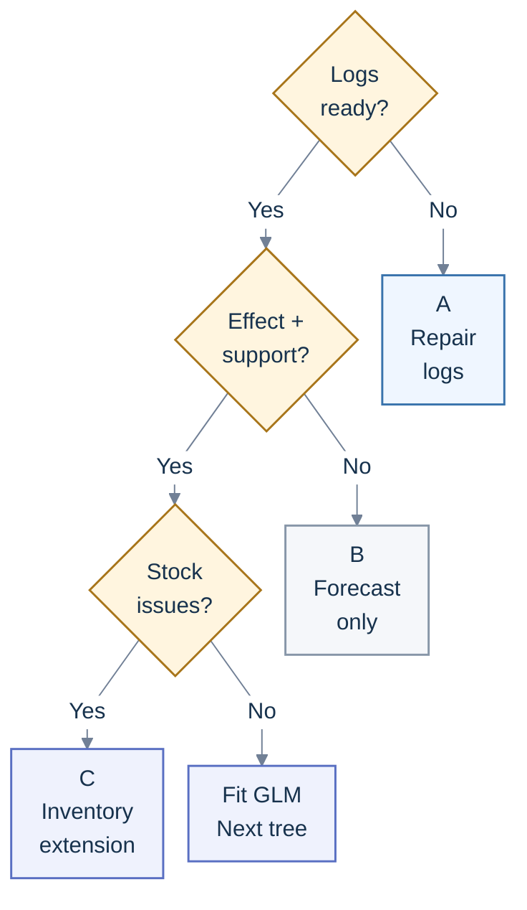
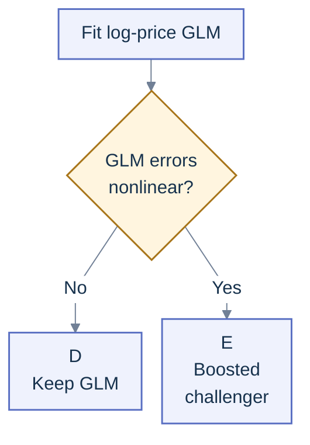
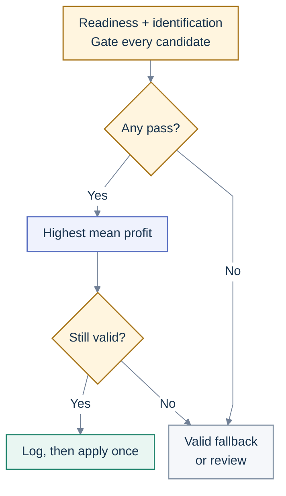

# Price recommendation: learn demand, then choose a price

**About 25 hours for the learning project.** &nbsp;·&nbsp; [Chapter 9](README.md) &nbsp;·&nbsp;
[Index](../README.md) &nbsp;·&nbsp; [Resources](resources/README.md)

**The short version.** Start with an interpretable demand model, compare it with a boosted tree, and
choose among prices the business has approved. The hard part is estimating demand **if you changed
the price**. Accurately predicting past prices or sales does not, by itself, answer that question.

My suggested first approach is a **log-price Poisson or negative-binomial GLM**, then a **CatBoost
or LightGBM demand challenger**, with a separate **constrained profit optimiser**. This is a
practical starting point, not a universal ranking. Your evidence for price effects, available price
variation, demand volume and operational constraints decide which model you can safely use.

**In this guide:** [Data contract](#2-build-a-table-of-opportunities-including-non-purchases) ·
[Model choice](#model-selection-decision-tree) ·
[Causal evidence](#4-identify-the-price-effect-before-optimizing-it) ·
[Price policy](#6-optimize-a-constrained-grid-with-an-explicit-abstain-path) ·
[Delivery](#7-serve-recommendations-that-can-be-replayed) ·
[Practice lab](#9-build-a-bounded-lab-before-proposing-production)

---

## Your project plan

Use the splitting and API habits from [Chapter 3](../03-core-machine-learning/README.md) and the
serving and monitoring habits from [Chapter 6](../06-production/README.md). Real pricing
experiments, approvals and waiting for returns take extra calendar time.

Read the [causal primer](causal-primer.md) first. The schedule assumes prepared opportunity data,
your earlier environment and an existing API boundary. Rebuilding data from scratch or a new serving
integration needs extra setup time. Finish the approved fixed-price baseline, supported demand
comparison and constrained grid before the optional 2026 research extensions.

| Time      | Focus                      | Build                                                               | Done when                                                             |
| --------- | -------------------------- | ------------------------------------------------------------------- | --------------------------------------------------------------------- |
| 3 hours   | Decision and data          | Price unit, horizon, cost definition, exposure and inventory checks | A data contract distinguishes zero demand, no exposure and stockout   |
| 5 hours   | Baselines                  | Current-price policy, seasonal demand baseline, log-price GLM       | Rolling validation and elasticity assumptions are documented          |
| 4 hours   | Challenger and uncertainty | One boosted demand model; demand calibration and intervals          | Accuracy and calibration compared by SKU, price and period            |
| 4 hours   | Recommendation             | Enumerate an approved price grid; enforce constraints and fallback  | Unsupported prices and unsafe inputs cannot become recommendations    |
| 4 hours   | Serve and evaluate         | Recommendation API, decision log, simulated experiment              | Request can be replayed and matched to a matured outcome              |
| 5 hours   | Buffer and write-up        | Failure exercise, experiment memo, model and policy cards           | Claims clearly distinguish simulation, prediction and causal evidence |

## 1. Define the decision before the model

Choose one unit, such as **SKU × store × next day**, and a fixed decision horizon. Say whether the
system recommends a posted price, a markdown, a subscription tier, a quote or a negotiated price,
since each has different actions, exposures and outcomes. This guide assumes one shared posted price
for a product and market over a stated interval.

Separate three questions:

| Question                                                  | Appropriate output                                                   | What it does not establish                             |
| --------------------------------------------------------- | -------------------------------------------------------------------- | ------------------------------------------------------ |
| What price was historically charged for similar products? | Observed-price regression, useful for a benchmark or review queue    | A price that improves demand or profit                 |
| How much would customers buy under candidate price `p`?   | A demand or conversion response under a specified price intervention | The best price without costs, capacity and constraints |
| Which allowed price maximises the business objective?     | A policy combining a response estimate with optimisation             | That the response estimate is causally valid           |

Write the intervention as `do(price = p)`: set the price while keeping the specified offer,
placement and availability policy fixed. Decide whether the objective is contribution profit,
clearance sell-through, revenue under a margin floor, or a longer-horizon customer objective. No
single objective fits every case. Agree the currency, tax treatment and horizon with the business
owner.

For a one-period SKU decision, a useful simplified objective is:

```text
profit(p, x) = (net_unit_receipt(p, x) - variable_unit_cost(x))
              × E[min(D(p, x), available_inventory) | do(price = p)]
              - expected_return_cost(p, x)
              - price_change_cost(p, x)

p* = argmax profit(p, x), over approved and supported prices only
```

Here `D` is latent customer demand (true demand, before stock limits) and `x` holds what is known at
decision time. Count refund losses once: inside net receipts or in a separate return term. Include
fulfilment, payment fees and other variable costs consistently. Fixed costs may cancel between
prices, but state that assumption. With scarce inventory, `E[min(D, inventory)]` generally differs
from `min(E[D], inventory)`, so a mean-only estimate can misprice a product with limited stock.

A daily optimiser can also sell stock cheaply today that would be worth more tomorrow. Start with
products where a one-period approximation is credible. Add a multi-period inventory model only when
replenishment, perishability or customers waiting for a better price require it.
[Dynamic pricing with limited supply](https://arxiv.org/abs/1108.4142) shows why capacity changes
the decision problem.

## 2. Build a table of opportunities, including non-purchases

Transactions alone miss people who saw the price and chose not to buy. Build a row for every
eligible product-market-period, using posted-price and availability logs to create zero-sales rows.
A missing row is not automatically zero demand.

| Field                                                                   | Required meaning                                                                         |
| ----------------------------------------------------------------------- | ---------------------------------------------------------------------------------------- |
| `sku_id`, `market_id`, `decision_at`, `horizon_end`                     | The decision unit and the interval governed by the price                                 |
| `posted_price`, `effective_paid_price`, `currency`                      | Price shown, price paid after promotions, and consistent monetary units                  |
| `price_valid_from`, `price_valid_to`                                    | Actual duration of exposure to each price; split a day when price changes                |
| `eligible_exposure`, `exposure_definition`                              | Eligible visits, offers shown, or hours of availability; state the denominator           |
| `units_sold`, `orders`, `returns`                                       | Distinct outcome definitions, with arrival and maturity timestamps                       |
| `inventory_start`, `replenishment`, `stockout_at`                       | Capacity and evidence that observed sales were censored                                  |
| `unit_cost_snapshot`, `fulfillment_cost`, `fee_rules`                   | Costs known at decision time; reconcile realised costs afterwards                        |
| `promotion`, `placement`, `campaign_assignment`                         | Discounts, visibility and concurrent interventions                                       |
| `competitor_snapshot_at`, `competitor_price`, `competitor_availability` | Comparable product, collection time and missing/stale indicators                         |
| `policy_version`, `experiment_id`, `assignment_probability`             | How assignment was selected; retain the full available action set and any later override |
| `event_at`, `available_at`, `snapshot_version`                          | When a fact occurred, when the service could know it, and which revision was used        |

Measure exposure carefully. For visit-level conversion, a customer who does not buy is a valid
negative example. For aggregate counts with unequal exposure, a GLM can use a log-exposure offset.
The
[scikit-learn Poisson example](https://scikit-learn.org/stable/auto_examples/linear_model/plot_poisson_regression_non_normal_loss.html)
shows the related rate-target and exposure-weight set-up. Zero exposure means no chance to observe
demand and cannot go through `log(0)`.

**Exposure can itself respond to price.** Search placement, traffic or customer visits may change
after a price change. Conditioning on that realised exposure can hide part of the total price
effect. State whether you estimate conversion given exposure or total period sales. For a total
effect, use pre-change exposure forecasts or model traffic jointly.

**Sales are not demand during a stockout.** Selling the last ten units tells you demand was at least
ten, not exactly ten. Keep censored periods and mark them. When they matter, use a censored
likelihood or an availability-aware choice/demand model. An uncensored subset is fine for a narrow
first baseline if you state its selection limits. Dropping stockouts can leave mostly low-demand
periods. Availability also changes substitution across products, as
[Conlon and Mortimer](https://www.nber.org/papers/w14315) show.

Check support for inventory levels too. If comparable observations were always capped at ten units,
they cannot show the demand tail needed to value an inventory of twenty without extra assumptions.
Lower-stock decisions may need the tail only up to their own cap. Mark model-based extrapolation
clearly and abstain when the needed tail or censoring assumptions are unvalidated.

Include day of week, holidays, seasonality, item age, category, store and lagged demand, using only
information available before the recommendation. Compute rolling features separately inside each
validation history. A future realised competitor price, end-of-day inventory, post-change page views
or a future return flag is not a pre-decision feature. Event time and availability time must both
come before the decision: a backfilled Monday transaction first loaded on Wednesday was unavailable
to Tuesday's recommendation.

Promotions, loyalty benefits and offer recommendations change the effective price. Track them
together, including who funds a discount. Optimising posted price and discount separately can spend
the same margin twice. Cross-item prices and availability matter for substitutes and complements, so
begin with an isolated category and test that assumption.

## 3. Use a model ladder with clear promotion conditions

### Model-selection decision tree

Choose a **demand estimator** first; a separate constrained optimiser picks among approved prices.
“Logs ready?” means usable demand, price exposure, cost and inventory histories. “Effect + support?”
needs defensible identification and observations near the candidate prices, not a good forecasting
score. For identified, uncensored demand, fit the GLM baseline before judging whether its remaining
errors justify a more flexible challenger.

#### 1. Check data, evidence and inventory readiness



The letters link each outcome to its requirements below. “Stock issues?” covers sales censored by
stockouts and decisions tied to future inventory or replenishment, which need a separate extension.
Having a model does not authorise a new price, and more rows cannot repair missing identification or
price support. The “Fit GLM” path continues in
[the promotion tree below](#2-decide-whether-the-glm-needs-a-challenger).

#### 2. Decide whether the GLM needs a challenger

Follow this tree after the readiness checks above. Fit the GLM first, then use forward error
analysis to decide whether a boosted comparison is worth running. Choosing a challenger does not
show it beats the baseline.



- **A · Repair the logs; keep the current approved policy.** Model: no new price-response model yet.
  Missing exposures, costs or inventory make the decision target unreliable. Required: posted
  prices, exposed opportunities including non-purchases, timestamped costs and stock/availability.
  Proceed when reconciliation and readiness checks pass, and forecast only what the records support.
  See the [data contract](#2-build-a-table-of-opportunities-including-non-purchases).
- **B · Forecast only; gather intervention evidence.** Model: a seasonal/count demand forecast,
  keeping the current approved pricing policy. Forecasting history cannot identify demand under a
  price change. Required for promotion: a bounded, approved price experiment or another defensible
  identification design, with local support for the proposed grid. Promote only within that
  identified, supported price region. See
  [price-effect identification](#4-identify-the-price-effect-before-optimizing-it) and the
  [experiment design](#8-design-an-experiment-around-the-market).
- **C · Add a censored-demand/inventory extension only when supported.** Model: a justified
  latent-demand distribution, with censor-aware estimation when sales are censored, plus a separate
  inventory optimisation model when decisions interact over time. Realised sales alone cannot reveal
  demand above available stock. Required: stock and availability histories, exposure, price/cost
  state, identifiable price effects and a validated observation/censoring model. Dynamic decisions
  also need replenishment and transition evidence. Promote after validating the observation model
  and demand-distribution calibration under the inventory rules; otherwise abstain from the
  unsupported price change. See the
  [stock-censored research and simulator extension](#what-the-2026-research-adds).
- **D · Start with a regularised log-price Poisson or negative-binomial GLM.** It gives an
  interpretable count-demand baseline, handles zero counts and can model exposure explicitly.
  Required: repeated product-market observations, valid exposure denominators, uncensored demand for
  this baseline, credible supported price variation and documented identification assumptions. Check
  forward performance, dispersion and uncertainty. See the
  [elasticity baseline](#the-elasticity-baseline).
- **E · Compare CatBoost or LightGBM with that GLM.** Rich features and nonlinear seasonal/product
  interactions can justify a flexible demand challenger. Required: the same identified price
  evidence and support, features available at decision time, and a held-out forward comparison of
  accuracy, calibration, response curves and operating cost. Keep the GLM if the challenger adds
  nothing useful. See the [boosted demand challenger](#the-boosted-demand-challenger).

Only a supported demand response moves on to the
[constrained price policy](#6-optimize-a-constrained-grid-with-an-explicit-abstain-path). There,
feasibility, predictive risk and selection-adjusted improvement gate **every** candidate before
selection. This tree organises the existing project work. Inventory and other advanced extensions
stay outside its 25-hour practice budget.

| Evidence and data regime                                           | Suggested model or approach                                                                | Gate before using it for decisions                                                        |
| ------------------------------------------------------------------ | ------------------------------------------------------------------------------------------ | ----------------------------------------------------------------------------------------- |
| Little price variation or incomplete logs                          | Current approved price; category rules; forecasting only                                   | Instrument the missing exposures and assignment process                                   |
| Repeated product-market observations with credible price variation | Regularised log-price Poisson/negative-binomial GLM, with SKU/store/calendar effects       | Plausible elasticity, adequate support and defensible identification                      |
| Rich tabular features and nonlinear seasonal/product interactions  | CatBoost or LightGBM demand model                                                          | Beats GLM on forward data; response curves and uncertainty remain credible                |
| Sparse products or new SKUs                                        | Hierarchical/partially pooled category elasticity plus item attributes                     | Category transfer validated on held-out products; conservative fallback                   |
| Identified heterogeneous price effects                             | DML or causal forest with a specified treatment-response model                             | Identification, residual price variation, cross-fitting and inference assumptions checked |
| Strong substitutions and assortment changes                        | Discrete-choice model, such as multinomial/nested logit, or a justified joint demand model | Choice set, outside option, availability and cross-price effects observed                 |
| Repeated decisions with approved exploration                       | Contextual bandit on a finite approved price grid                                          | Correct propensities, matured reward, limited loss budget and operational stop rules      |

These promotion gates are engineering recommendations. Model documentation sets out supported losses
and estimator assumptions, not which model wins on your data.

### The elasticity baseline

For counts, fit the conditional mean instead of taking the log of observed zero sales:

```text
log E[units | p, x] = log(exposure)
                     + item_effect + store_effect + calendar_effect
                     + beta × log(p) + other_pre_decision_features
```

Here `beta` is the elasticity of the conditional mean: a 1% price increase goes with roughly a
`beta`% change in demand, holding the modelled features fixed. An estimate of `-1.4` suggests about
a 1.4% decrease. It is a **causal elasticity** only under the identification assumptions in the next
section.

A Poisson log-link handles zero counts naturally. Check for overdispersion (variance above the
mean); a negative-binomial model may fit it better. Use partial pooling or regularisation when many
products have little price variation. If you fit log-log regression on positive sales instead, state
that zeros are excluded and handle retransformation bias. `log1p(units)` loses the usual elasticity
meaning.
[statsmodels documents the GLM families and links](https://www.statsmodels.org/stable/glm.html).

Check how your implementation handles dispersion. In statsmodels' negative-binomial GLM family, you
supply `alpha`; choosing the family does not estimate it. Estimate or tune dispersion on training
data with a suitable count model, then check the tails on held-out data. The
[family documentation](https://www.statsmodels.org/stable/generated/statsmodels.genmod.families.family.NegativeBinomial.html)
states this contract.

### The boosted demand challenger

CatBoost is a useful challenger when product, store and category identifiers matter most. LightGBM
suits larger tabular panels. Both support Poisson and quantile objectives, as the
[CatBoost loss documentation](https://github.com/catboost/catboost/blob/master/catboost/docs/en/concepts/loss-functions-regression.md)
and [LightGBM parameters](https://lightgbm.readthedocs.io/en/latest/Parameters.html) show. Choose by
careful validation and operating needs, not a generic leaderboard.

Use a count loss for units. For zero-heavy, nonnegative continuous spending, compare a Tweedie or
two-part model where suitable. A hurdle model can separate whether someone buys from how many units,
but the extra complexity needs validation. Keep the response scale explicit: a library may return a
raw log score or a transformed mean, depending on prediction settings.

Inspect demand curves across the supported price grid in real customer-market contexts. A monotonic
constraint (demand falls as price rises) can encode a reasonable own-price assumption, but it cannot
fix confounding. Check that your objective supports that constraint in the pinned library version.
Flexible trees extrapolate poorly beyond observed prices, and a smooth curve does not prove a price
change will work.

A boosted Poisson-loss model estimates a conditional mean. That objective alone does not validate a
Poisson demand distribution, and a few fitted quantiles are not a complete distribution either. For
inventory or downside-risk calculations, supply a coherent nonnegative demand distribution or a
justified tail estimator, and validate dispersion, tail calibration and interval ordering. Keep
uncertainty in the fitted mean separate from future demand variation.

### When advanced models earn their place

For strong substitutes, estimate category demand and the no-purchase outside option, instead of
maximising each SKU's apparent profit separately. A choice model's assumptions and feasibility
matter as much as its fit. Personalised individual pricing is a separate product-policy decision
that a pooled product-market demand model does not need.

Use a bandit only when exploration has been approved for the defined market and price grid. Start
with a randomised fixed-grid experiment. Later, a contextual bandit can give more exposure to
promising allowed prices while still exploring. Log the chosen action's real probability after all
filters, inventory checks and policy constraints. The
[Vowpal Wabbit tutorial](https://vowpalwabbit.org/tutorials/contextual_bandits.html) explains the
context/action/reward/probability contract. A bandit optimising immediate purchases can lose money
after discounts, returns or longer-term effects, so define a matured contribution reward.

**Delayed feedback changes the learning contract.** Declare a fixed return/settlement horizon and an
allowance for late data. Keep recent decisions pending instead of giving them zero reward or
updating only on quick outcomes. A whole decision cohort matures under one rule, and its reward may
still miss later returns, so state that limit. Delays or missing outcomes can depend on price and
reward. The peer-reviewed
[ICML study of unrestricted delay distributions](https://proceedings.mlr.press/v139/lancewicki21a.html)
separates reward-independent from reward-dependent delays, and ordinary bandit updates are not
automatically valid in both. Start with scheduled updates on mature cohorts and an incumbent
fallback. More elaborate delay-aware learning is an optional extension.

For a faster purchase or revenue proxy, individual-level correlation with settled profit is not
enough. Check, with uncertainty, whether the **randomised price effects** on the proxy point the
same way as those on matured contribution. The
[August 2026 delayed-feedback workshop paper by Lee and colleagues](https://arxiv.org/abs/2608.11560)
examines reward alignment and learning efficiency separately. Its marketplace example is
underpowered, later overall lift is null and positive subgroup findings are exploratory, so it does
not validate a retail pricing reward. Compare against an approved fixed-price policy, and confirm
any proxy-driven policy with experimental settled-profit outcomes.

<a id="what-the-2026-research-adds"></a>

### Optional depth: what the 2026 research adds

<details>
<summary>Continuous-treatment models and stock-censored demand research</summary>

**Pretrained continuous-treatment models.** The May 2026
[CCPFN preprint, revised in July](https://arxiv.org/abs/2605.15133), studies in-context
dose-response estimation using synthetic causal-model priors. It is an optional challenger for an
identified price-response task, not a way to extract causal elasticity from any sales history. It
needs the relevant confounders and local treatment support, and its benchmarks are mostly synthetic
or semi-synthetic. Compare it with the GLM and a cross-fitted causal baseline on the same supported
price region, future cohorts, response uncertainty and inference cost. Test prior mismatch
explicitly. A smooth curve does not mean it learned the effect of prices that were never in the
experiment.

**Learning with stock-censored demand.**
[Zhang, Wang and Luo's September 2026 preprint](https://arxiv.org/abs/2609.32949) develops
Double-Grid-UCB and Threshold-UCB for stationary bounded demand, nonincreasing expected sales with
price at each inventory cap, and inventory known before pricing. Threshold-UCB shares demand-tail
information across inventory levels. Its support is theory and simulations; seasonal drift,
substitution, replenishment decisions and live profit gains need separate work.

Adaptive prices and inventory can also break ordinary i.i.d. Kaplan–Meier confidence arguments, so
the paper builds estimates for its own observation process. A censoring flag alone cannot justify a
survival estimator's uncertainty.

The practical lesson holds even with a GLM: log available stock, keep sales separate from latent
demand, and estimate a demand distribution when stock limits the decision. Two made-up demand
processes both have mean 10. One always sells 10 if available. The other has demand 0 or 20, each
with probability one half. With inventory 10, expected served demand is **10 and 5** respectively. A
mean-only forecast cannot tell their stock-limited contribution apart.

For nonnegative integer demand and integer inventory, the identity is:

```text
E[min(D, I) | price, context] = sum from q=1 to I of P(D >= q | price, context)
```

In a simulator, a finite-inventory extension can compare a naive sales-as-demand fit, a justified
censored-demand model and an inventory-aware exploration policy. Vary stockouts and demand drift.
Adapting its revenue objective to contribution is new work, and the regret guarantee does not carry
over automatically. These optional extensions need an exploration and loss budget before live use.

</details>

## 4. Identify the price effect before optimizing it

Managers often lower prices when they expect weak sales and raise them when demand is strong. Past
prices then carry demand information the model may not see. Price and sales can rise together even
when raising the price reduces demand. Fixed effects, SHAP and better forecast scores do not fix
this on their own.

Prefer a **randomised price experiment** within a small approved grid, stratified by product, market
and relevant calendar blocks. Run a concurrent current-policy control. Record assignment, realised
exposure, overrides and outcomes. Define the primary effect as assignment to the pricing policy, so
overrides cannot quietly change the population being compared.
[Fisher, Gallino and Li](https://pubsonline.informs.org/doi/10.1287/mnsc.2017.2753) give a
controlled retail example that uses randomised prices to address this endogeneity problem. Its
reported improvement is specific to that setting, not a forecast for yours.

For observational estimation, write down an identification argument before choosing the estimator:

- **Adjustment/DML:** all common causes of price assignment and demand are recorded, enough price
  variation remains within comparable contexts, and treatment and outcome definitions are
  consistent. Avoid conditioning on anything the price change itself affects. DML cross-fitting
  reduces some estimation biases, but it cannot reveal missing confounders. The
  [EconML DML documentation](https://www.pywhy.org/EconML/spec/estimation/dml.html) also sets out
  structural assumptions. A continuous-treatment causal forest estimates effects within those
  assumptions, and a local marginal effect is not automatically a complete nonlinear demand curve.
- **Instrumental variables:** the instrument changes price, is independent of unobserved demand
  shocks given the stated controls, and affects demand only through price. Report first-stage
  strength, the population and variation identified, and any extra functional-form or monotonicity
  assumptions. A competitor's price or your cost is not automatically a valid instrument, because
  common shocks, advertising and availability can create other paths to demand.
  [EconML's instrument guide](https://www.pywhy.org/EconML/spec/estimation_iv.html) describes this
  distinction. A more recent competitive-pricing study,
  [Jiang and Li](https://pubsonline.informs.org/doi/abs/10.1287/opre.2022.0157), combines
  experiments and instrumental estimation in its own setting.
- **No credible identification:** use the model only as a forecast or analyst simulator, keep the
  approved current policy, and design an experiment. Label counterfactual numbers as unvalidated
  scenarios. Adding `CausalForestDML` to the code does not change that evidence gate.

For continuous price, support means real variation near the proposed price **within comparable
contexts**, not just lying between the global minimum and maximum. If every item was always priced
differently, cross-item variation cannot identify an item's own-price effect. Plot price variation
by SKU, store and season, and show which decisions must abstain.

## 5. Validate forecasting, response and business value separately

**Prediction validation.** Use forward rolling windows on the SKU-store panel. Use a later final
period once; tune only on earlier windows. Add held-out stores or products when deployment must
serve unseen groups. A group split alone cannot prevent temporal leakage, and a time split alone
cannot test cold-start products. Fit encoders and transformations within each training window. Use
dependence-aware folds for causal nuisance models, since library defaults may assume independent
rows.

Report seasonal-baseline, GLM and challenger results on the same rows. Use count deviance and MAE,
with bias and observed-versus-predicted totals by SKU, store, season, stock availability and price
band. MAPE breaks at zero demand. WAPE is undefined when total actual demand is zero and can hide
poor low-volume performance. Keep uncensored demand checks apart from realised sales checks, and
state what is being forecast.

**Response validation.** On randomised or otherwise identified held-out data, compare demand and
profit by assigned price, show uncertainty, and inspect monotonicity and heterogeneous effects.
Report how much supported price variation remains after controls. Good MAE under the current price
policy does not validate a new price curve.

**Uncertainty.** Keep three things apart: variation in future customer demand, uncertainty about the
estimated causal mean response, and uncertainty about the policy's profit improvement. Quantile
models can estimate demand prediction intervals; check their coverage, width, pinball loss and
calibration on later data and operational slices. Check distributional count models for tail
behaviour and stockout probability too. A refit/cluster bootstrap or estimator-specific inference
can measure response-estimation uncertainty under the relevant assumptions.

Ordinary conformal coverage relies on assumptions that temporal drift may break, so rolling coverage
checks and adaptation are needed.
[Gibbs and Candès](https://proceedings.neurips.cc/paper_files/paper/2021/hash/0d441de75945e5acbc865406fc9a2559-Abstract.html)
study adaptive conformal inference under shift. Neither conformal prediction nor quantile
calibration gives causal validity or guaranteed coverage for an unsupported candidate price.

**Coverage after choosing a price.** Per-price average coverage may not hold once a policy picks
different prices in different contexts. The
[July 2026 Zheng and Jin preprint](https://arxiv.org/abs/2607.02206) studies this with
policy-coupled coverage under i.i.d. logging, supported identified actions and known assignment
probabilities, separating model fitting, policy learning and calibration. It is optional research.
Validate the frozen policy's selected-action coverage on independent identified data with a
justified weighting or design strategy. Pooled coverage under the current policy is not enough, and
a multiplicity adjustment for mean improvement does not solve this predictive-risk problem.

A made-up counterexample makes this concrete. Two prices each miss five of the same 100 contexts, on
separate sets, so each has 95% coverage. A policy that picks each price in exactly the contexts it
misses has only 90% selected-price coverage. These are constructed outcomes, not observed customer
counterfactuals, but an optimiser can unintentionally favour poorly covered contexts.

**Policy validation.** Compare against the current pricing rule, with matured contribution profit
per randomised unit and horizon as the primary outcome. Also track sell-through, revenue, stockout
rate, returns, complaints, repeat purchase and constraint violations. Estimate uncertainty at the
assignment unit: thousands of customer events in one treated market are not thousands of independent
treatment assignments.

Offline policy evaluation needs the candidate policy's actions to have support under the logged
assignment mechanism, and valid reward/assignment assumptions. On a finite price grid, IPS and
doubly robust estimates can help. Inspect propensity errors, extreme weights, effective sample size
and interval width. [Dudík, Langford and Li](https://arxiv.org/abs/1103.4601) describe the doubly
robust approach, which cannot repair missing support or unmeasured confounding. Generic IPS on logs
from a deterministic current policy cannot evaluate a different deterministic price.
Continuous-price evaluation needs suitable density or smoothing assumptions, and binning prices
afterwards does not create randomised data. A model-only profit simulation is not an observed lift.

Evaluating a **fixed learned policy** differs from evaluating an adaptive learner that updates as
feedback arrives. The learner's actions depend on its history, so a one-shot IPS/DR score for its
final policy misses cold-start learning, pending rewards and inventory depletion. For those claims,
use a justified sequential evaluation design or a bounded live trial.

## 6. Optimize a constrained grid, with an explicit abstain path

Choose a small price grid approved by the relevant business owners. Apply constraints before ranking
and again after selection:

- Price floors/ceilings, positive unit contribution where required, and a margin floor.
- Maximum change from the current price, minimum time between changes, rounding and price endings.
- Inventory, replenishment, contractual and campaign restrictions.
- Consistent customer-facing price/quote rules and any applicable organisational policies.
- Valid cost, competitor and feature timestamps, and candidate prices within identified support.

Decide what happens when the current price itself is no longer allowed. A fallback must come from a
currently approved policy. If there is none, return `review_required` with no executable price. The
optimiser cannot invent an exception to restore availability.

### The policy flow

Before comparing expected profits, pass **every candidate** through feasibility, local support,
predictive risk and a selection-adjusted improvement rule. Each check keeps only passing prices. The
identification gate uses the design and assumptions in
[Section 4](#4-identify-the-price-effect-before-optimizing-it), not a predictive score.



The first stage checks input readiness and causal identification, then tests every approved price
for feasibility, local support, predictive risk and selection-adjusted mean improvement. If a
precondition fails, no candidate passes. Pick the highest expected profit among the survivors only,
recheck the current state, and log durably before delivery. Revalidate the approved fallback before
using it. If none is still valid, execute nothing and return `review_required`.

### A worked example

Assume a cost of **₹60 per unit**, enough inventory, no extra fees or returns, and the following
**illustrative identified mean demand** for one day. These made-up values show the arithmetic, not
an elasticity estimate from a public dataset.

| Approved price | Expected units | Expected revenue | Expected contribution profit |
| -------------- | -------------: | ---------------: | ---------------------------: |
| ₹90            |            140 |          ₹12,600 |   `(90 - 60) × 140 = ₹4,200` |
| ₹100, current  |            115 |          ₹11,500 |  `(100 - 60) × 115 = ₹4,600` |
| ₹110           |             95 |          ₹10,450 |   `(110 - 60) × 95 = ₹4,750` |
| ₹120           |             76 |           ₹9,120 |   `(120 - 60) × 76 = ₹4,560` |

Under these assumptions, ₹110 has the highest expected contribution profit: **₹150 above the current
policy**, about **3.26%**. ₹90 maximises the table's revenue, a different objective. A 5% change
limit from ₹100 would rule ₹110 out. If uncertainty about the profit difference still includes an
unacceptable loss, a conservative rule would keep the approved fallback, even though ₹110 has the
highest estimated mean.

**Try it yourself.** A supplier cuts the unit cost to ₹50 and the demand estimates are unchanged.
Which approved price now has the highest expected contribution profit, and what should the policy
recommend?

<details>
<summary>Hint and explained answer</summary>

Recompute `(price - 50) × units`. ₹90 gives `40 × 140 = ₹5,600`, ₹100 gives `50 × 115 = ₹5,750`,
₹110 gives `60 × 95 = ₹5,700` and ₹120 gives `70 × 76 = ₹5,320`. The current ₹100 now wins, ₹50
ahead of ₹110, so the policy keeps the current price. A lower cost makes each extra unit worth more
and moves the best price lower. Revenue still favours ₹90, because revenue ignores cost. The ₹50
margin, under 1% of profit, shows how a cost change can flip a close choice. Check such gaps with
paired uncertainty before changing a price.

</details>

Use **paired estimates of profit difference** for a conservative improvement bound. Subtracting the
ends of two unrelated prediction intervals does not give a confidence interval for lift. Choose
minimum improvement and loss thresholds before seeing experimental results. To pair estimates, refit
on the same bootstrap sample, or take the same parameter-posterior draw, for every price. This
captures covariance in the estimated mean responses. Randomised price data can identify each price's
marginal outcome distribution under the design assumptions, not one person's joint potential
outcomes across prices.

To estimate model uncertainty, refit the demand and nuisance estimators with a dependence-aware
resampling scheme. Resampling fixed predictions alone misses that fitting uncertainty. Label a
posterior bound as conditional on its model and prior, not as a distribution-free confidence
guarantee. If live monitoring tests for improvement repeatedly, fix an analysis schedule in advance
or use justified sequential inference. A fixed-sample interval does not allow unlimited peeking.

```python
# Pseudocode: response inference and predictive risk are separate dependencies.
def recommend(context, policy, response_model):
    fallback = policy.valid_fallback(context)  # Can be None: then review_required.
    if not context.features_fresh or not context.costs_valid:
        return abstain(fallback, reason="stale_or_invalid_inputs")
    if not response_model.price_effect_identified:
        return abstain(fallback, reason="unvalidated_price_effect")

    candidates = [
        p for p in policy.approved_prices(context)
        if policy.allows(p, context)
        and response_model.has_local_support(p, context)
    ]
    if not candidates or fallback is None:
        return abstain(fallback, reason="no_supported_feasible_action")
    if not response_model.has_local_support(fallback, context):
        return abstain(fallback, reason="cannot_compare_with_fallback")

    # Each refitted bootstrap model (or parameter draw) estimates each price's
    # marginal demand distribution. Integrate that distribution to calculate
    # expected profit, applying inventory and costs once. No paired customer
    # outcomes across counterfactual prices are assumed.
    fits = response_model.inference_fits(context)
    mean_profit = policy.integrated_profit_by_fit(
        fits, prices=candidates + [fallback], context=context)
    passing_prices = {}
    for price in candidates:
        # Predictive variation governs operating risk, such as stockouts or
        # a future-period loss limit. Check every candidate before selection.
        demand = response_model.predictive_demand_distribution(price, context)
        future_profit = policy.predictive_profit_distribution(demand, price, context)
        if not policy.operating_risk_acceptable(future_profit):
            continue
        mean_gain = mean_profit[price] - mean_profit[fallback]
        if not policy.mean_improvement_supported(
                mean_gain, candidate_family=mean_profit):  # Selection-adjusted rule.
            continue
        passing_prices[price] = future_profit
    if not passing_prices:
        return abstain(fallback, reason="no_candidate_passes_evidence_and_risk")
    best = max(passing_prices, key=lambda p: mean_profit[p].mean())
    if not policy.allows(best, context):
        return abstain(fallback, reason="constraints_changed")
    return decision(best, alternatives=candidates, mean_profit_summary=mean_profit,
                    predictive_risk_summary=passing_prices[best],
                    evidence=response_model.evidence_version)
```

The support check and improvement rule are contracts you implement, not magic confidence scores.
Define their diagnostics, estimation assumptions and thresholds in the policy card, and record both
gates there. A full future-profit distribution supports risk decisions; statistical confidence in
**mean lift** is a different calculation. Validate the marginal predictive distributions used for
risk, and let the mean-improvement inference account for picking the best of several candidates.
`operating_risk_acceptable` must reject an unvalidated distribution or inventory regime, so a mean
forecast cannot quietly pass as a predictive-risk certificate. Include estimation uncertainty and
plausible cost/return scenarios in the risk sensitivity checks. Apply the adjustment to the full
supported, feasible candidate family, and do not narrow it after seeing risk or profit estimates.
State may change after scoring, so revalidate cost, inventory and policy version when applying a
recommendation.

## 7. Serve recommendations that can be replayed

A daily batch job is usually enough for a first posted-price system. Version the response model,
policy configuration and price application separately. Use an API when operators or downstream
systems need a consistent recommendation contract.

```json
{
  "request_id": "price-2026-10-08-001",
  "sku_id": "SKU-17",
  "market_id": "STORE-3",
  "decision_at": "2026-10-08T08:00:00+05:30",
  "horizon_hours": 24,
  "currency": "INR",
  "current_price_minor": 10000,
  "cost_snapshot_id": "cost-17-v4",
  "inventory_snapshot_id": "stock-3-v21",
  "policy_version": "pricing-v2"
}
```

Validate currency, positive prices, horizon, timestamps and snapshot ownership. Resolve approved
prices and constraints on the server, so the caller cannot relax them. Money uses integer minor
units, with currency-specific rules defined in the contract.

Return `decision_id`, `status` (`recommended`, `fallback`, `review_required`), recommended or null
price, validity interval, supported alternatives, expected contribution, uncertainty semantics,
reason codes, model version, policy version and snapshot versions. A demand interval must state its
unit, horizon and nominal coverage. A mean-lift confidence interval must state the comparison policy
and inference method. Avoid a generic percentage called “confidence.”

Save the pre-decision feature snapshot, grid, eliminated candidates and reasons, response estimates,
selected price, assignment probability, operator override, applied price and actual exposure. Join
purchases and matured returns using `decision_id` plus the decision unit and time interval. Log the
action actually taken even if an operator overrides it, and keep the original experimental
assignment for the planned analysis. Make retries idempotent, and stop an expired recommendation
from overwriting a newer price.

Save a pending application record before delivery. Tie the idempotency key to the exact price, unit,
interval and release, then check the current price and version atomically when applying it. Reject a
changed or expired state instead of overwriting a newer decision, and reconcile an unknown delivery
result before retrying. The response's alternatives are diagnostic, not permission to apply a price
that failed a gate.

An operator override may have an unknown selection probability. Mark it clearly, and do not reuse
the original randomisation probability as the override's propensity. These records can stay in an
intention-to-treat analysis, but offline evaluation of actual actions needs a justified way to
handle them.

Monitor stale inputs, cost changes, price application failures, recommendation/application gaps,
abstention rate, supported-action coverage, price oscillation, margin-floor breaches and latency.
Once outcomes mature, add profit, bias, demand interval coverage, returns, repeat purchase and
complaints. Show outcome completeness by decision cohort, so a recent cohort does not look more
profitable just because its returns have not arrived.

Set named owners and triggers for rolling back to the approved fallback, such as a sudden margin
drop, broken stock logging or too many constraint violations. Retraining is a reviewed response to
evidence, not the automatic answer to every drift alert.

## 8. Design an experiment around the market

Prices can affect neighbouring products, customer search and a competitor's response. A customer may
also wait to buy until the next price change. Choose an assignment unit that contains the important
interference: store, market or category clusters may work better than randomising each visit. If
time switchbacks fit, randomise the blocks and allow for carryover, washout and replenishment
cycles. [Bojinov, Simchi-Levi and Zhao](https://arxiv.org/abs/2009.00148) study switchback design
under carryover assumptions. Simply alternating prices by day is not a valid randomised design.

Write a pre-experiment memo covering the action grid, allocation unit, primary profit metric,
minimum detectable effect, number of independent clusters or blocks, duration, return-maturity
window, customer-policy constraints and stop rules. Keep the same primary analysis if results
disappoint. Analyse cross-item effects at category or market level when that is the business
objective. A short-run best response to competitors differs from a lasting market effect, as
competitors may react after the first test.

## 9. Build a bounded lab before proposing production

**Use synthetic data with a known demand mechanism for the intervention lab.** Public retail
transactions can teach cleaning and forecasting, but they generally cannot show what a price change
would cause. [UCI Online Retail](https://archive.ics.uci.edu/dataset/352/online+retail) has
transaction timestamps, quantities, unit prices and cancellations. Its documented schema lacks
exposure to unpurchased prices, inventory and randomised price assignment, so do not label a
regression on that dataset a validated optimal-price engine.

**The simulator below is a specification for you to build; the repository does not include it.**
Practise first with the [reference lab](../labs/README.md). Its pricing example has one product,
three prices and assumed conversion probabilities, written to a
[price comparison](../labs/reference/price-comparison.csv) and a
[pricing figure](../labs/reference/pricing.svg). It checks only the contribution arithmetic: it
estimates no demand and has no confounded prices, stores, seasonality or stockouts.

For the 25-hour project, keep your generator to 20 products, three stores, 140 days and four
approved prices per product. Use seeded generation and save the generator configuration. Model
isolated products first, and leave assortment and multi-period inventory optimisation as extensions.

1. Generate exposure and count demand with a known log-price effect, store/product effects and
   seasonality. Hide the true parameters from the training pipeline. Use ample inventory for the
   core training, calibration and evaluation experiment, and check that no demand is censored.
   Observed units then equal demand, so the baseline has a valid uncensored target.
2. Generate two clearly labelled assignment regimes: randomised approved prices with known
   probabilities, and manager-chosen prices that depend on a hidden demand shock. The second shows
   confounding and is not causal training data. Include zero-sales rows and return delays, with some
   outcomes deliberately incomplete at the final observation date.
3. Fit the seasonal baseline, log-price GLM and one boosted demand model on forward windows. Keep
   separate later windows for calibration and testing. Compare observed sales forecasting and
   identified response estimation separately. Cluster uncertainty at the simulated assignment unit,
   and document the independence built into the generator.
4. Implement the price-grid optimiser, then compare its decisions with the simulator's known
   expected-profit optimum over the same feasible actions. Report simulated regret and abstention,
   plus matured profit. Score it on independent simulation draws, not on the optimiser's own
   predictions. Check predictive coverage for the selected actions as well as by price. The
   simulator supplies those outcomes without claiming observed individual counterfactuals. Freeze
   model, calibration and policy before the final test.
5. Run a separate stockout stress scenario with finite inventory and sales observed as
   `min(latent_demand, inventory)`. Keep those records out of the uncensored baseline's training
   data, and show that it abstains outside its approved inventory regime. A censor-aware model is an
   optional extension: it estimates latent demand, and the optimiser applies the inventory cap once.
   Avoid training on capped sales as if they were demand and then capping that forecast again. In a
   failure exercise, remove exposure logs or stockout flags and show why validation rejects the
   data. Request an out-of-support price and change inventory after scoring, to test fallback and
   execution revalidation.
6. Serve one recommendation request, save its decision log and replay it from saved versions. Write
   an experiment memo for replacing synthetic identification with a real approved trial.

Deliver a reproducible generator, feature/data contract, split diagram, comparison table, response
curves, interval-calibration report, optimiser, API example and policy card. Label every result
“synthetic” or “observational” as appropriate. The simulator's known elasticity says nothing about a
real retailer.

## Before increasing scope

| Stage                           | Evidence required to progress                                                                                                                   |
| ------------------------------- | ----------------------------------------------------------------------------------------------------------------------------------------------- |
| Learner prototype               | Reproducible synthetic results; honest forward splits; zero/stockout handling; correct profit arithmetic; unsupported-action fallback           |
| Internal shadow recommendations | Real posted-price/exposure/cost reconciliation; policy and support checks; no price application; operator review of failures                    |
| Small approved experiment       | Identification plan; complete assignment and applied-price logs; adequate independent units; prespecified guardrails and matured rewards        |
| Limited production              | Experiment supports the chosen business objective; interval calibration and failure paths pass; rollback and application revalidation exercised |
| Broader or adaptive policy      | New markets/products have support; longer-term/category effects assessed; exploration budget and delayed-feedback handling are operational      |

You are ready to explain the project when you can answer: **what evidence identifies the price
effect, which candidate prices are supported, why the selected price improves the stated objective,
and what the service does when any of those conditions fails.**

---

[Previous: Offer recommendation](offer-recommendation.md) &nbsp;·&nbsp; [Next: Churn](churn.md)
&nbsp;·&nbsp; [Back to Chapter 9](README.md)
