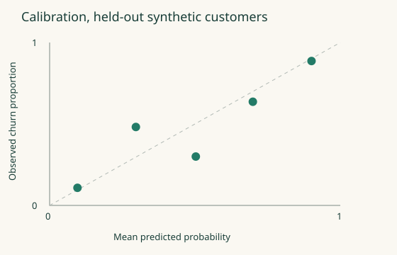
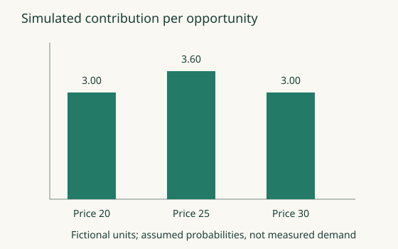

# Evaluation report — simulated reference lab

**Evidence level:** synthetic prototype. **Decision:** `pass_simulated_gate`.
**Contact experiment:** `inconclusive`.
It shows no real customer performance, causal benefit or production readiness.

## Frozen protocol

One unique customer per row. Cohorts in time order: 300 training, 150 calibration and
150 final-test customers. Training labels mature before calibration snapshots, and calibration
labels mature before test snapshots. Both event time and availability time limit features.
Standardisation and logistic weights use training data only. A separate calibration cohort
fits a sigmoid and picks cost thresholds for both baseline and candidate. The final cohort is
opened once, after those choices are frozen.

| Measure | Training-prevalence baseline | Calibrated logistic candidate |
| --- | ---: | ---: |
| Test customers | 150 | 150 |
| Log loss, lower is better | 0.695751 | 0.495936 |
| Brier score, lower is better | 0.251300 | 0.169020 |
| ROC AUC | 0.500000 | 0.837216 |
| Chosen threshold | 0.05 | 0.15 |
| FP×2 + FN×10 per customer | 0.986667 | 0.760000 |

Threshold-dependent costs use the listed policies. The release gate compares probability
quality only. It does not show that the candidate's action policy improves real outcomes.

Candidate-minus-baseline mean log-loss difference: **-0.199816**.
Paired percentile-bootstrap 95% interval: **[-0.289922, -0.115393]**,
using 1000 draws, with unique customers as the independent resampling unit.
These finite-sample bootstrap estimates hold only for this simulator and cohort design.

Gate, set in advance: upper interval bound below −0.01 and no worse Brier score.
A defer result stands. Do not tune on the final test until it passes.

## Judge arithmetic fixture

Positive means an acceptable answer. Human labels against a hypothetical judge on 50
hand-built cases: TP=26, FN=4, FP=3, TN=17. Precision is 26/29=0.8966.
Recall is 26/30=0.8667. False acceptance among unacceptable answers is 3/20=0.15.
This is an arithmetic fixture, not a measured model judge. For a sensitive task, three
false accepts may be too many, even when overall agreement looks good.

## Business decisions

Prices 20, 25 and 30 have assumed conversion probabilities 0.30, 0.24 and 0.15.
With unit cost 10, expected contribution per opportunity is 3.00, 3.60 and 3.00.
Price 20 wins on conversion. Price 25 wins on contribution.
The probabilities are simulator assumptions. Observational price correlations could not prove them.

For six hypothetical accounts and a contact budget of eight, risk ranking picks the two
high-risk accounts for expected incremental contribution **-4.00**.
Known-effect ranking picks the two saveable accounts for **28.00**.
These are oracle illustrations. A real policy needs identified effects and independent policy evaluation.

The separate randomised simulation assigns contact with probability 0.5. Failed
deliveries stay in their assigned arms (intention to treat). Assigned arms: 374 control and 426
contact accounts. The 385 contact-arm deliveries are reported separately. Sample-ratio
check before reading lift: chi-square 3.380, p = 0.0660 against the designed
allocation. The alarm, set in advance, is p < 0.001.

| Contact minus control, net contribution per assigned account | Fictional units |
| --- | ---: |
| Intention-to-treat difference | -0.219427 |
| Standard error, unequal arm variances | 3.399424 |
| Normal-approximation 95% interval | [-6.882298, 6.443444] |
| Minimum detectable effect, 80% power, two-sided 5% | 9.518388 |

**Experiment decision:** `inconclusive`.
The interval includes zero, so this run cannot support a claim of benefit or harm.
The simulator's designed effect, known here only because the data are simulated, is
2.706750 per assigned account. Detecting it with the book's delivery-plan
approximation, `2 × (1.96 + 0.84)^2 × variance / effect^2`, needs about 4,912 accounts per arm.
This experiment is underpowered for that effect.
A real plan fixes its size before launch, from pre-treatment variance and a minimum worthwhile effect chosen upfront.

## Limitations and next experiment

The generator deliberately resembles its fitted model and uses independent synthetic customers.
Real data have measurement errors, censoring, repeated users, selection and shifting treatment effects.
Before a real pilot, document permissions and coverage, identify effects, size a prospective test
for power, check delivery and outcome instrumentation, set guardrails in advance and name an owner.
See the [full evaluation](evaluation.json), [release manifest](release-manifest.json),
[data card](data-card.md), [model card](model-card.md) and [incident rehearsal](incident-report.md).
